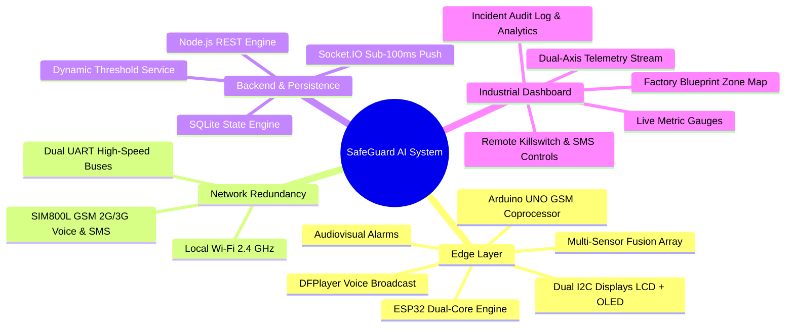
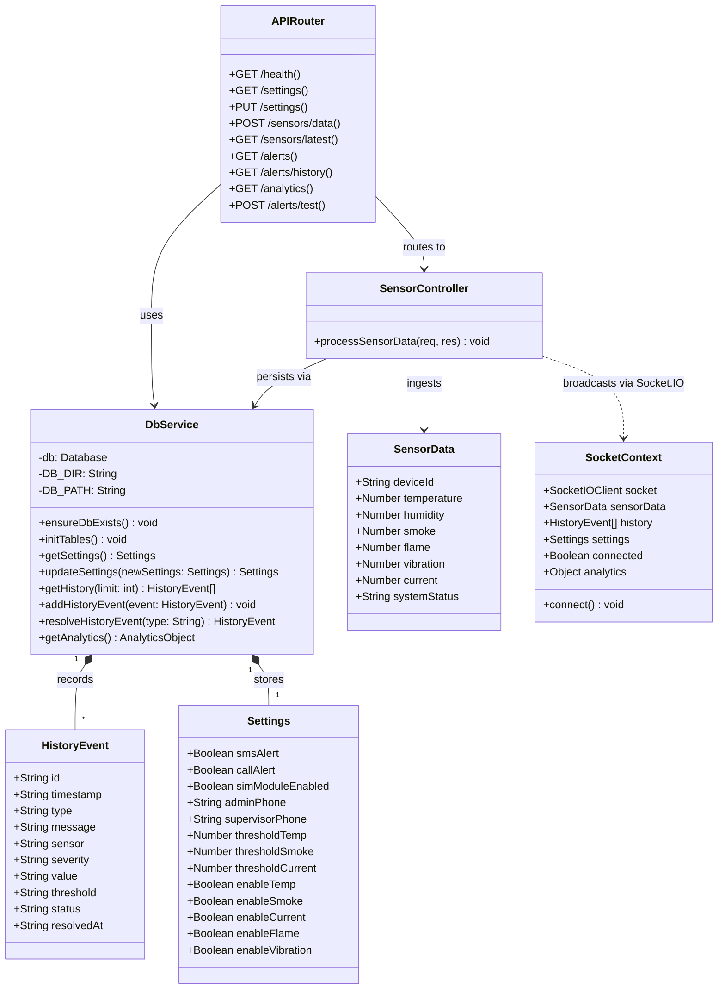
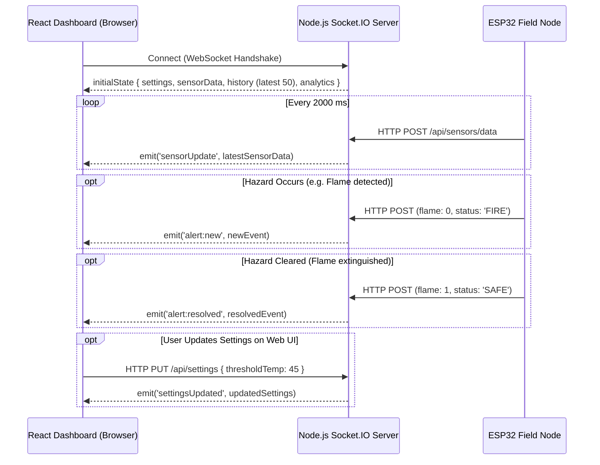
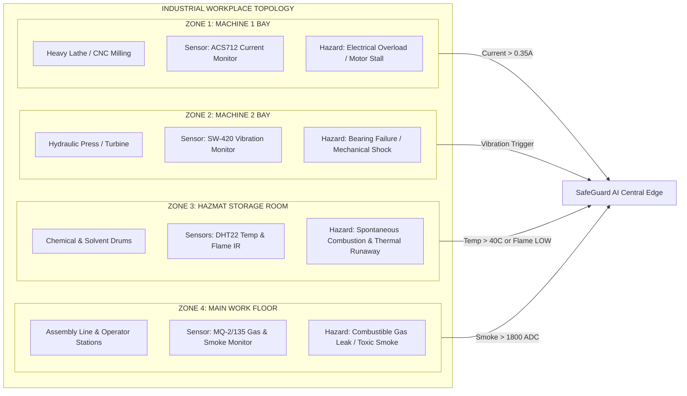
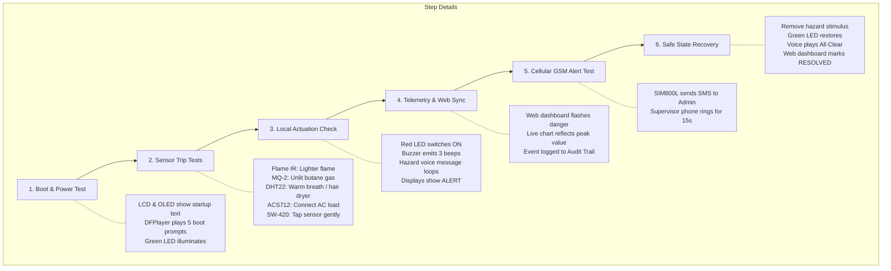
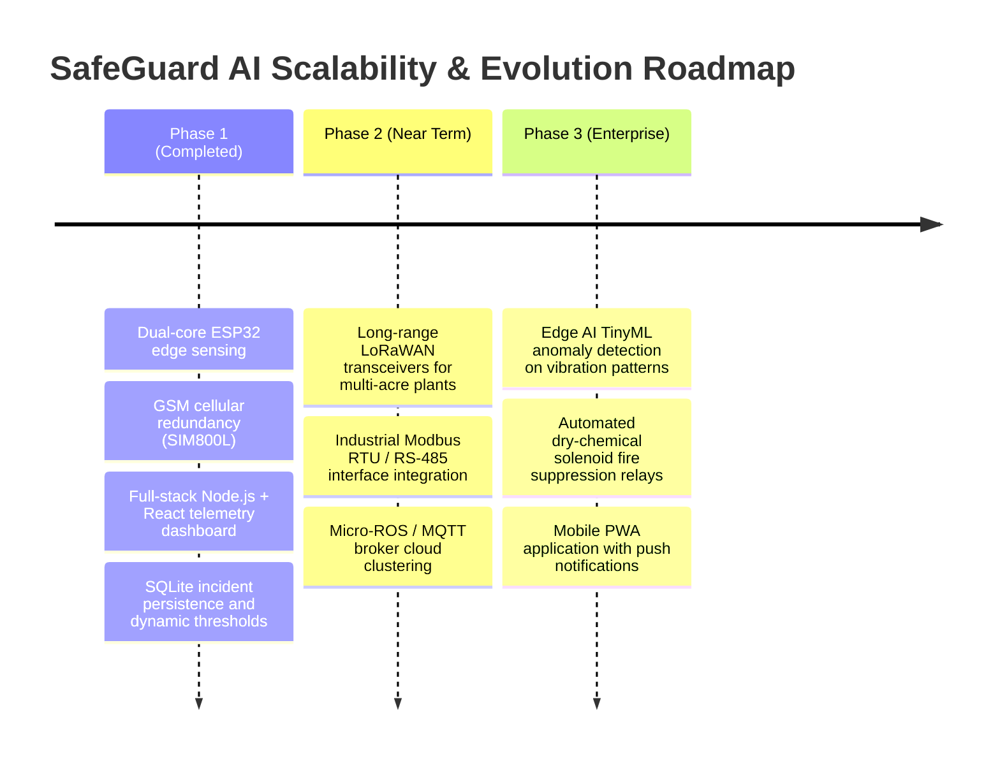

# 🛡️ Smart Workplace Safety Management System (SafeGuard AI)
### *Next-Generation Industrial IoT Safety Net, Real-Time Edge Telemetry & Dual-Channel Emergency Escalation*

[](https://www.espressif.com/)
[](https://simcom.ee/)
[](https://nodejs.org/)
[-blue.svg?style=for-the-badge&logo=sqlite)](https://sqlite.org/)
[](https://socket.io/)
[](https://react.dev/)
[](https://tailwindcss.com/)

---

## 📑 Table of Contents
1. [Executive Summary & Project Overview](#-1-executive-summary--project-overview)
2. [Project Team & Mentorship](#-2-project-team--mentorship)
3. [End-to-End System Architecture](#-3-end-to-end-system-architecture)
4. [Hardware Components Deep Dive](#-4-hardware-components-deep-dive)
5. [Pinout & Interconnection Master Matrix](#-5-pinout--interconnection-master-matrix)
6. [Edge Microcontroller Firmware & Working](#-6-edge-microcontroller-firmware--working)
7. [Emergency Alert Escalation & GSM Subsystem](#-7-emergency-alert-escalation--gsm-subsystem)
8. [Backend Architecture & Database Services](#-8-backend-architecture--database-services)
9. [REST API & WebSocket Specifications](#-9-rest-api--websocket-specifications)
10. [Frontend Web Dashboard & User Interface](#-10-frontend-web-dashboard--user-interface)
11. [Factory Topology & Zone Safety Mapping](#-11-factory-topology--zone-safety-mapping)
12. [End-to-End Sequence & State Machine Diagrams](#-12-end-to-end-sequence--state-machine-diagrams)
13. [Installation, Wiring & Configuration Guide](#-13-installation-wiring--configuration-guide)
14. [Testing, Calibration & Verification Procedures](#-14-testing-calibration--verification-procedures)
15. [Troubleshooting & Maintenance Manual](#-15-troubleshooting--maintenance-manual)
16. [Future Enhancements & Scalability Roadmap](#-16-future-enhancements--scalability-roadmap)

---

## 🌟 1. Executive Summary & Project Overview

Industrial manufacturing plants, chemical processing facilities, heavy machinery shop floors, and commercial warehouses are high-risk work environments susceptible to catastrophic incidents: **flash fires, toxic or combustible gas leaks, electrical overload arcs, and destructive mechanical vibration failures**.

Traditional workplace safety mechanisms suffer from three critical bottlenecks:
1. **Isolated Local Alarms:** Sirens and flashers are frequently inaudible in high-noise factory floors and provide zero remote awareness.
2. **Human-Dependent Escalation:** Relying on on-site personnel to dial emergency teams or evacuate introduces lethal delays.
3. **Single Point of Network Failure:** Typical cloud-only IoT monitors stop functioning the moment factory Wi-Fi or local broadband drops during an emergency.

### The SafeGuard AI Solution
The **Smart Workplace Safety Management System (SafeGuard AI)** is an enterprise-grade, multi-tiered Industrial IoT (IIoT) ecosystem designed to provide **sub-second threat detection, physical audio-visual alarming, cellular fail-safe voice & SMS dispatch, and real-time supervisory web control**.



### Key Capabilities & Highlights
- **Fast-Loop Sensing (200ms):** Immediate polling for critical analog/digital signals (Flame, Smoke/Gas, Overcurrent, Vibration).
- **Physics-Compliant Slow-Loop (2000ms):** Precise sampling for capacitive/thermistor readings (DHT22 Temp & Humidity) avoiding thermal drift.
- **Fail-Safe Cellular Redundancy (GSM/GPRS):** If Wi-Fi fails or electrical lines burn, the dedicated **Arduino UNO + SIM800L** subsystem directly dials phones and fires SMS alerts over cellular networks.
- **Live Bidirectional Synchronization:** Dynamic safety thresholds (temperature cutoffs, gas parts-per-million levels, overcurrent trigger points) can be reconfigured live from the web dashboard without recompiling or reflashing microcontrollers.
- **Auditable Safety Compliance:** Every alert lifecycle event (Triggered -> Active -> Severity -> Value vs Threshold -> Resolved) is persistently recorded in SQLite with millisecond timestamps.

---

## 👥 2. Project Team & Mentorship

| Role | Name | Responsibilities & Domain Ownership |
| :--- | :--- | :--- |
| **Project Guide & Mentor** | **Miss. Bijal Tayade** | Overall Architectural Guidance, Safety Standards Compliance & Review |
| **Hardware & Firmware Lead** | **Rohan M. Patil** | Hardware/Software Interfacing, ESP32 Dual-Loop Firmware, Serial Protocol Design |
| **Hardware Assembly Specialist**| **Parshw R. Pomaje** | Circuit Assembly, Power Distribution, Sensor Mounting & Packaging |
| **Backend & Cloud Architect** | **Vivek R. Patil** | Node.js Express REST API, Socket.IO WebSockets, SQLite Schema & State Engine |
| **Frontend & UI/UX Engineer** | **Darshan R. Bandgar** | React 19 Application, Real-Time Telemetry Visualizer, Tailwind Design System |

---

## 🏗️ 3. End-to-End System Architecture

The project is structured around a **Three-Tier Decentralized Architecture** that isolates safety-critical hardware operations from high-level web visualization.

```mermaid
graph TB
    subgraph Tier1["TIER 1: EDGE & FIELD HARDWARE LAYER"]
        direction TB
        subgraph Sensors["Sensor Array"]
            S1["DHT22 (Pin 4)<br/>Temp & Humidity"]
            S2["MQ-2/135 (Pin 34)<br/>Combustible Gas & Smoke"]
            S3["Flame IR (Pin 27)<br/>Fire Detection"]
            S4["ACS712 (Pin 35)<br/>Current Monitor"]
            S5["SW-420 (Pin 5)<br/>Vibration Sensor"]
        end

        subgraph EdgeControllers["Dual Edge Controllers"]
            ESP["ESP32 DevKit V1<br/>Master Controller (240MHz)<br/>- 200ms Fast Sensor Polling<br/>- 2000ms Slow DHT Polling<br/>- State Machine & Escalation"]
            UNO["Arduino UNO R3<br/>Comms Coprocessor (16MHz)<br/>- Dedicated AT Command Engine<br/>- Command Parser (115200 baud)"]
        end

        subgraph LocalActuators["Local Alarms & Displays"]
            LCD["16x2 I2C LCD (0x27)<br/>Metric Display"]
            OLED["0.96 inch SSD1306 OLED (0x3C)<br/>Diagnostic Display"]
            AUDIO["DFPlayer Mini + Speaker<br/>Voice Warning System"]
            LEDS["Dual LED Beacon<br/>Green (Safe) / Red (Danger)"]
            BUZZER["Active Piezo Buzzer<br/>3-Beep Pattern Alarm"]
        end

        subgraph Cellular["Cellular Subsystem"]
            SIM["SIM800L GSM Module<br/>- Voice Call Dispatch<br/>- Emergency SMS Broadcast"]
        end
    end

    subgraph Tier2["TIER 2: CORE SERVER & DATABASE LAYER"]
        direction TB
        SERVER["Node.js + Express API Server (Port 5000)"]
        WS["Socket.IO Server<br/>Bidirectional WebSocket Hub"]
        SQLITE[("SQLite Database<br/>(better-sqlite3)<br/>- history table<br/>- settings table")]
        CONTROLLER["Sensor & State Controller<br/>Dynamic Threshold Verifier"]
    end

    subgraph Tier3["TIER 3: PRESENTATION & CLIENT DASHBOARD"]
        direction TB
        CLIENT["React 19 + Vite Dashboard (Port 5173)"]
        VIEWS["Dashboard Modules:<br/>1. Live Monitoring & Gauges<br/>2. Emergency Control Center<br/>3. Factory Diagnostics & Topology<br/>4. Incident Audit Logs<br/>5. Analytics & Metrics Cards"]
    end

    %% Edge Connections
    Sensors -->|Analog / Digital| ESP
    ESP -->|I2C Bus (SDA:21, SCL:22)| LCD
    ESP -->|I2C Bus (SDA:21, SCL:22)| OLED
    ESP -->|UART2 (RX:16, TX:17)| AUDIO
    ESP -->|GPIO Control (18, 19, 25)| LEDS
    ESP -->|GPIO Control (18, 19, 25)| BUZZER
    ESP -->|UART1 Serial (TX:33 -> RX:0)| UNO
    UNO -->|SoftwareSerial (10, 11)| SIM

    %% Edge to Server Connections
    ESP -->|HTTP POST /api/sensors/data (2000ms)| SERVER
    ESP -->|HTTP GET /api/settings (5000ms)| SERVER

    %% Server Internal Connections
    SERVER --- CONTROLLER
    CONTROLLER --- SQLITE
    CONTROLLER --- WS

    %% Server to Client Connections
    WS <==>|Real-Time Push (sensorUpdate, alerts)| CLIENT
    CLIENT -->|HTTP PUT /api/settings| SERVER
    CLIENT -->|HTTP POST /api/alerts/test| SERVER
    CLIENT --- VIEWS

    %% Cellular to Humans
    SIM -.->|Cellular Voice Call (ATD)| PHONE["Safety Admin & Supervisor Phone"]
    SIM -.->|Emergency SMS (AT+CMGS)| PHONE
```

---

## 🧰 4. Hardware Components Deep Dive

### 1. ESP32 DevKit V1 (Master Controller)
- **Processor:** Dual-core 32-bit Xtensa LX6 @ 240 MHz.
- **Memory:** 520 KB SRAM, 4 MB external SPI Flash.
- **Wireless Connectivity:** 802.11 b/g/n Wi-Fi transceiver (2.4 GHz) & Bluetooth v4.2 BR/EDR/BLE.
- **Role in Project:** Primary telemetry hub. Handles non-blocking fast/slow sampling loops, drives dual I2C visual screens, evaluates hazard threshold state machines, drives DFPlayer Mini audio warnings, and transmits HTTP REST packets.

### 2. Arduino UNO R3 (Comms Coprocessor)
- **Microcontroller:** Microchip ATmega328P 8-bit AVR @ 16 MHz.
- **Memory:** 32 KB Flash (0.5 KB used by bootloader), 2 KB SRAM, 1 KB EEPROM.
- **Role in Project:** GSM modem co-processor. Isolates timing-sensitive AT command handshakes from the ESP32. Listens over Hardware UART at 115200 baud, executes AT strings on SIM800L via SoftwareSerial (Pins 10 & 11) at 9600 baud, and oversees dial timers without blocking sensor polling.

### 3. SIM800L GSM / GPRS Module
- **Frequency Bands:** Quad-band 850 / 900 / 1800 / 1900 MHz.
- **Supply Voltage:** **3.7V - 4.2V DC (Peak current requirement: 2.0A during GSM burst transmission)**.
- **SIM Card Slot:** Micro-SIM with active 2G/3G/4G voice & SMS plan.
- **Role in Project:** Off-grid emergency telecommunications. Dispatches automated SMS alert text messages and executes automated phone calls to safety personnel when hazards occur.

### 4. DHT22 / AM2302 (Environmental Temperature & Humidity)
- **Sensors:** Capacitive humidity sensing element & NTC temperature sensor.
- **Operating Range:** Temperature: -40°C to +80°C (accuracy ±0.5°C); Humidity: 0% to 100% RH (accuracy ±2%).
- **Sampling Frequency:** Maximum 0.5 Hz (one read every 2 seconds).
- **Interface:** Single-bus proprietary digital protocol with internal 4.7kΩ pull-up.

### 5. MQ-2 / MQ-135 Gas & Smoke Sensor
- **Sensing Medium:** Tin Dioxide ($SnO_2$) ceramic heating element.
- **Detects:** Liquefied Petroleum Gas (LPG), Propane, Methane, Hydrogen, Alcohol, Carbon Monoxide, and Suspended Smoke particles.
- **Output:** Analog DC voltage (0.1V to 3.3V after voltage divider / ESP32 attenuation) proportional to gas concentration.

### 6. Infrared Flame Detection Sensor
- **Photodiode Spectrum:** High sensitivity to infrared light in the 760 nm to 1100 nm wavelength band (typical open fire hydrocarbon emission).
- **Output:** Digital output (Active LOW when flame is detected, HIGH when ambient).
- **Response Time:** < 15 microseconds.

### 7. ACS712 Linear Current Sensor (Hall Effect)
- **Principle:** Hall-effect IC outputting a precise analog voltage linearly proportional to AC or DC current flowing through internal copper conduction paths.
- **Sensitivity:** 66 mV/A (for 30A model) or 185 mV/A (for 5A model).
- **Zero Current Voltage:** $V_{CC} / 2 \approx 2.5\text{V}$.
- **Firmware Processing:** Evaluated by averaging 30 continuous ADC samples, converting to voltage, and deriving Amperage:
  $$\text{Amps} = \left|\frac{V_{measured} - 2.5\text{V}}{0.066\text{ V/A}}\right|$$

### 8. SW-420 Mechanical Vibration Sensor
- **Sensor Type:** High-sensitivity spring-type omnidirectional non-directional vibration sensor module with LM393 voltage comparator.
- **Output:** Digital HIGH during shock/vibration excursions, LOW when quiescent.
- **Application:** Detects machinery bearing failures, structural oscillations, or seismic tremors.

### 9. DFPlayer Mini MP3 Audio Decoder & Speaker
- **Decoding Format:** Hardware MP3 and WAV decoding with 24-bit DAC output (dynamic range 90dB).
- **Storage:** MicroSD card (FAT16/FAT32 format, up to 32GB).
- **Integrated Amplifier:** On-board 3W mono amplifier driving an 8Ω / 3W speaker.
- **Serial Interface:** UART @ 9600 baud, 8N1.

#### 🎙️ DFPlayer Mini Voice Prompt Mapping Matrix
| Track # | Audio File | Trigger Condition / Event | Spoken Announcement |
| :---: | :--- | :--- | :--- |
| `001` | `0001.mp3` | System Power-On Boot Step 1 | *"Welcome to SafeGuard AI Safety System."* |
| `002` | `0002.mp3` | System Power-On Boot Step 2 | *"Initializing all safety sensors and diagnostics."* |
| `003` | `0003.mp3` | System Power-On Boot Step 3 | *"Connecting to industrial wireless network."* |
| `004` | `0004.mp3` | System Power-On Boot Step 4 | *"Network connected. Server synchronization active."* |
| `005` | `0005.mp3` | System Power-On Boot Step 5 | *"System armed and actively monitoring workplace."* |
| `006` | `0006.mp3` | Hazard: Smoke / Gas Exceeded | *"Warning! High smoke and gas levels detected! Evacuate immediately."* |
| `007` | `0007.mp3` | Hazard: Fire / Temp / Overcurrent | *"Emergency alert! Critical hazard detected! Security personnel notified."* |
| `008` | `0008.mp3` | Safe State Recovery | *"Hazard resolved. All parameters returned to safe operating levels."* |

### 10. Visual Displays & Annunciators
1. **16x2 Character I2C LCD:**
   - Backpack: PCF8574 I2C Expander (Address `0x27`).
   - Normal Mode: Displays real-time Temperature (°C), Humidity (%), Smoke level, and Fire presence.
   - Danger Mode: Flashes `!!! ALERT !!!` alongside the active hazard type (`FIRE`, `SMOKE`, `HIGH_TEMP`, `OVER_CURRENT`, `VIBRATION`).
2. **0.96" SSD1306 Monochrome OLED (128x64):**
   - Protocol: I2C (Address `0x3C`).
   - Displays real-time current load ($A$), localized temperature ($^\circ C$), vibration trip state, and raw gas ADC counts.
3. **Dual-Color LED Beacon & Buzzer:**
   - **Green LED (Pin 18):** Illuminated during normal/safe operating regime.
   - **Red LED (Pin 19):** High-intensity indicator activated upon hazard trip.
   - **Active Piezo Buzzer (Pin 25):** Emits a distinct 3-beep pattern ($150\text{ms ON} / 150\text{ms OFF}$) during transition to danger.

---

## 🔌 5. Pinout & Interconnection Master Matrix

### Complete Wiring & Pin Assignment Table

| Source Device / Module | Module Pin | Target Controller | Controller Pin | Electrical Standard / Protocol | Purpose / Description |
| :--- | :--- | :--- | :--- | :--- | :--- |
| **DHT22** | DATA / OUT | ESP32 | **GPIO 4** | 1-Wire Digital (Pull-up) | Temperature & Humidity sampling |
| **DHT22** | VCC / GND | ESP32 | 3.3V / GND | Power | 3.3V DC Power Rail |
| **MQ-2 / 135** | A0 (Analog) | ESP32 | **GPIO 34** | Analog Input (ADC1_CH6) | Gas/Smoke analog concentration |
| **MQ-2 / 135** | VCC / GND | Power Supply | 5.0V / GND | Power | 5V Heater Power Rail |
| **Flame Sensor** | D0 (Digital)| ESP32 | **GPIO 27** | Digital Input (Active LOW) | Fire flame detection |
| **ACS712 Sensor**| OUT | ESP32 | **GPIO 35** | Analog Input (ADC1_CH7) | Current transducer analog output |
| **SW-420 Sensor**| DO (Digital)| ESP32 | **GPIO 5** | Digital Input | Shock and vibration trigger |
| **Green LED** | Anode (+) | ESP32 | **GPIO 18** | Digital Output (Active HIGH)| Safe status indicator |
| **Red LED** | Anode (+) | ESP32 | **GPIO 19** | Digital Output (Active HIGH)| Danger status indicator |
| **Active Buzzer** | Positive (+) | ESP32 | **GPIO 25** | Digital Output (Active HIGH)| Acoustic warning buzzer |
| **DFPlayer Mini**| RX | ESP32 | **GPIO 17 (TX2)** | UART Serial (9600 baud) | ESP32 transmits audio play commands |
| **DFPlayer Mini**| TX | ESP32 | **GPIO 16 (RX2)** | UART Serial (9600 baud) | ESP32 receives player feedback |
| **DFPlayer Mini**| VCC / GND | Power Supply | 5.0V / GND | Power | Audio power rail |
| **16x2 I2C LCD** | SDA | ESP32 | **GPIO 21 (SDA)** | I2C Bus (`0x27`) | Data line for character display |
| **16x2 I2C LCD** | SCL | ESP32 | **GPIO 22 (SCL)** | I2C Bus (`0x27`) | Clock line for character display |
| **0.96" OLED** | SDA | ESP32 | **GPIO 21 (SDA)** | I2C Bus (`0x3C`) | Shared I2C data line |
| **0.96" OLED** | SCL | ESP32 | **GPIO 22 (SCL)** | I2C Bus (`0x3C`) | Shared I2C clock line |
| **ESP32 Intercom**| TX1 | Arduino UNO | **Pin 0 (RX)** | UART Serial (115200 baud) | ESP32 sends `ALERT\|...` to UNO |
| **ESP32 Intercom**| RX1 | Arduino UNO | **Pin 1 (TX)** | UART Serial (115200 baud) | ESP32 receives responses from UNO |
| **Arduino UNO** | Pin 11 (TX) | SIM800L | **RXD** | SoftwareSerial (9600 baud)| AT command transmission to modem |
| **Arduino UNO** | Pin 10 (RX) | SIM800L | **TXD** | SoftwareSerial (9600 baud)| AT command feedback from modem |
| **SIM800L** | VCC / GND | Buck Converter| 4.0V / GND (2A)| Independent Power | **Requires 2A burst current & 1000uF cap** |
| **Common Ground**| GND | ALL MODULES | **GND Bus** | Ground Reference | **MANDATORY: Shared common ground** |

> [!CAUTION]
> **SIM800L Current Spikes:** The SIM800L module draws up to 2.0A during GSM network transmission bursts. Powering the SIM800L directly from the Arduino 5V pin will cause instantaneous voltage brownouts, resetting the microcontroller. Use an external DC-DC step-down buck converter (e.g., LM2596) set to **4.0V DC**, with a $1000\mu\text{F}$ low-ESR electrolytic capacitor soldered across the SIM800L $V_{CC}$ and $GND$ pins.

---

## ⚡ 6. Edge Microcontroller Firmware & Working

The ESP32 firmware (`hardware.ino`) executes a multi-rate, non-blocking cooperative scheduling architecture powered by `millis()` timing loops. This prevents slow operations (such as DHT sensor reads or HTTP requests) from causing latency in emergency detection.

```mermaid
flowchart TD
    Start([System Boot]) --> InitHardware[Initialize GPIOs, I2C, UARTs]
    InitHardware --> LEDBoot[Green LED ON, Red LED OFF, Buzzer Beep]
    LEDBoot --> InitDisplays[Init LCD 0x27 & OLED 0x3C]
    InitDisplays --> ConnectWiFi{Connect to Wi-Fi}
    ConnectWiFi -- Success --> InitDFPlayer[Initialize DFPlayer Mini]
    ConnectWiFi -- Timeout --> InitDFPlayer
    InitDFPlayer --> BootAudio[Play 5-Step Voice Boot Sequence]
    BootAudio --> MainLoop[[Main Loop Execution]]

    subgraph FastLoop["Fast Loop (Every 200 ms)"]
        MainLoop --> ReadFast[Sample MQ Smoke Analog ADC<br/>Read Flame Sensor Digital<br/>Read Vibration Sensor Digital<br/>Compute ACS712 30-Sample Avg Current]
        ReadFast --> UpdateOLEDDisp[Update 0.96 inch OLED Display]
        UpdateOLEDDisp --> EvalSafety{Check Safety Conditions<br/>Flame == LOW?<br/>Smoke > Threshold?<br/>Temp > Threshold?<br/>Current > Threshold?<br/>Vibration == HIGH?}
        
        EvalSafety -- Hazard Detected --> DangerBranch[Danger State Active<br/>Red LED ON / Green LED OFF<br/>Play 3-Beep Acoustic Buzzer<br/>Trigger DFPlayer Loop Audio Track 6/7]
        DangerBranch --> CooldownCheck{Debounce Cooldown<br/>Expired? > 30s}
        CooldownCheck -- Yes --> SendUnoUART[Send 'ALERT|TYPE|SMS|CALL|NUM' to UNO]
        CooldownCheck -- No --> LoopEnd
        SendUnoUART --> LoopEnd

        EvalSafety -- All Safe --> SafeBranch[Safe State Active<br/>Green LED ON / Red LED OFF<br/>Buzzer OFF<br/>If previously in danger: Play Track 8 All Clear<br/>Reset Alert Debounce]
        SafeBranch --> LoopEnd
    end

    subgraph SlowLoop["Slow Loop (Every 2000 ms)"]
        MainLoop --> ReadDHT[Read DHT22 Temperature & Humidity]
        ReadDHT --> UpdateLCDDisp[Update 16x2 Character LCD Display]
    end

    subgraph HttpTelemetryLoop["HTTP Telemetry Loop (Every 2000 ms)"]
        MainLoop --> PostPayload[Format JSON Payload<br/>POST to /api/sensors/data]
    end

    subgraph SettingsSyncLoop["Settings Sync Loop (Every 5000 ms)"]
        MainLoop --> GetSettings[GET /api/settings<br/>Update Thresholds & Phone Numbers]
    end

    LoopEnd --> MainLoop
```

### Sensor Mathematical Calibration Formulas

#### 1. ACS712 Hall-Effect Current Sensor
The ESP32 ADC operates with 12-bit resolution ($0 - 4095$ counts) referenced to $3.3\text{V}$:
```cpp
long adcSum = 0;
for(int i = 0; i < 30; i++) {
    adcSum += analogRead(CURRENT_PIN);
}
int currentADC = adcSum / 30;

float currentVoltage = (currentADC / 4095.0) * 3.3;
float currentAmp = (currentVoltage - 2.5) / 0.066; // 66mV/A for 30A module
if (currentAmp < 0) currentAmp = -currentAmp;
if (currentAmp < 0.05) currentAmp = 0.00; // Noise floor cutoff
```

#### 2. Flame Photodiode Sensor
- The infrared flame sensor module incorporates an onboard LM393 comparator.
- In normal conditions, the digital output is pulled **HIGH**.
- When exposed to infrared radiation from a flame (wavelengths $760 - 1100\text{ nm}$), the output switches **LOW**:
```cpp
if (enableFlame && flameValue == LOW) {
    dangerType = 2;
    currentDanger = true;
    dangerTypeStr = "FIRE";
}
```

#### 3. MQ-2 / MQ-135 Gas & Smoke Sensor
The analog output produces a variable DC potential proportional to smoke density and combustible gases:
```cpp
if (enableSmoke && smokeValue > smokeThreshold) {
    dangerType = 1;
    currentDanger = true;
    dangerTypeStr = "SMOKE";
}
```

---

## 📡 7. Emergency Alert Escalation & GSM Subsystem

To guarantee emergency delivery when workplace networks are disrupted, the system incorporates a dedicated **Arduino UNO + SIM800L** subsystem.

### Inter-Controller Communication Protocol
Communication between the ESP32 and Arduino UNO takes place over **UART1 at 115200 baud** using a pipe-delimited structured syntax:

$$\texttt{ALERT}\ |\ \langle\texttt{HAZARD\_TYPE}\rangle\ |\ \texttt{SMS}=\langle 0|1\rangle\ |\ \texttt{CALL}=\langle 0|1\rangle\ |\ \texttt{NUM}=\langle\texttt{+PHONE}\rangle$$

#### Example Telemetry Command
```text
ALERT|FIRE|SMS=1|CALL=1|NUM=+918999259299
```

### Arduino UNO Firmware Execution (`arduino_code.ino`)
When an alert packet is received, the ATmega328P parses the payload and dispatches Hayes AT commands to the SIM800L:

```mermaid
sequenceDiagram
    autonumber
    participant ESP as ESP32 Master
    participant UNO as Arduino UNO
    participant SIM as SIM800L GSM Module
    participant NET as Cellular Base Station
    participant TEL as Supervisor Smartphone

    ESP->>UNO: ALERT|FIRE|SMS=1|CALL=1|NUM=+918999259299 (UART 115200)
    Note over UNO: Parses Alert Type, SMS toggle, Call toggle, Dynamic Phone Number
    
    rect rgb(30, 41, 59)
        Note over UNO,SIM: SMS Transmission Pipeline
        UNO->>SIM: AT+CMGF=1 (Set SMS Text Mode)
        SIM-->>UNO: OK
        UNO->>SIM: AT+CMGS="+918999259299"
        SIM-->>UNO: > (Prompt)
        UNO->>SIM: SMART WORKPLACE SAFETY ALERT\n\nAlert: FIRE\nLocation: Workplace\nCheck immediately.[Ctrl+Z]
        SIM->>NET: Dispatch SMS PDU
        NET-->>TEL: Deliver Emergency SMS Text
        SIM-->>UNO: +CMGS: [ID] OK
    end

    rect rgb(15, 23, 42)
        Note over UNO,SIM: Voice Call Initiation Pipeline
        UNO->>SIM: ATD+918999259299; (Dial Audio Voice Call)
        SIM->>NET: Initiate GSM Voice Call
        NET-->>TEL: Phone Rings Alerting Personnel
        Note over UNO: Maintains Call Active for 15,000 ms (15s)
        UNO->>SIM: ATH (Hang Up Call)
        SIM-->>UNO: OK
    end
```

> [!TIP]
> **Anti-Spam Debounce Filter:** Both the ESP32 and Arduino firmware feature a **30-second cooldown timer**. If a fire continues burning, the system sounds continuous local alarms but prevents cellular network throttling or carrier SIM blocking by moderating subsequent SMS/Call dispatches.

---

## 🖥️ 8. Backend Architecture & Database Services

The backend server is implemented in **Node.js with Express v4**, utilizing **better-sqlite3** for high-speed synchronous disk persistence, and **Socket.IO v4** for real-time WebSocket communication.

### Class Diagram & Service Relationships



### Database Schema (SQLite)

#### Table 1: `history` (Incident Audit Trail)
Stores every safety incident lifecycle event from trigger to resolution:
```sql
CREATE TABLE IF NOT EXISTS history (
    id TEXT PRIMARY KEY,          -- Unique Timestamp Epoch String
    timestamp TEXT,               -- ISO 8601 Trigger Timestamp
    type TEXT,                    -- 'FIRE', 'SMOKE', 'HIGH_TEMP', 'OVER_CURRENT', 'VIBRATION'
    message TEXT,                 -- Descriptive Incident Message
    sensor TEXT,                  -- 'Flame', 'Smoke', 'Temperature', 'Current', 'Vibration'
    severity TEXT,                -- 'CRITICAL', 'WARNING', 'INFO'
    value TEXT,                   -- Sensor Value at time of trigger
    threshold TEXT,               -- Configured threshold breached
    status TEXT,                  -- 'ACTIVE' or 'RESOLVED'
    resolvedAt TEXT               -- ISO 8601 Timestamp when condition returned to SAFE
);
```

#### Table 2: `settings` (Dynamic System Configuration)
Stores runtime parameters dynamically adjustable from the web UI:
```sql
CREATE TABLE IF NOT EXISTS settings (
    key TEXT PRIMARY KEY,         -- Setting identifier
    value TEXT                    -- Stored value (serialized)
);
```

Default settings seeded on database initialization:
- `smsAlert`: `'1'` (Enabled)
- `callAlert`: `'0'` (Disabled)
- `simModuleEnabled`: `'1'` (Ready)
- `adminPhone`: `''` (Configurable via UI)
- `supervisorPhone`: `''` (Configurable via UI)
- `thresholdTemp`: `'40'` (°C)
- `thresholdSmoke`: `'1800'` (Raw ADC counts)
- `thresholdCurrent`: `'0.35'` (Amperes)

---

## 🌐 9. REST API & WebSocket Specifications

### RESTful Endpoints Reference

| HTTP Method | Route | Request Payload | Response | Description |
| :---: | :--- | :--- | :--- | :--- |
| `GET` | `/api/health` | None | `{"status": "OK"}` | Server health verification |
| `GET` | `/api/settings` | None | `Settings` Object | Fetches all operational thresholds & toggles |
| `PUT` | `/api/settings` | Partial `Settings` Object | Updated `Settings` Object | Updates configuration and triggers WebSocket broadcast |
| `POST` | `/api/sensors/data` | `SensorData` JSON | `{"status": "OK"}` | Ingests ESP32 telemetry, runs safety checks & logs incidents |
| `GET` | `/api/sensors/latest` | None | `SensorData` JSON | Returns cached in-memory sensor reading |
| `GET` | `/api/alerts` | None | `HistoryEvent[]` | Retrieves all currently active incidents (`status = 'ACTIVE'`) |
| `GET` | `/api/alerts/history` | None | `HistoryEvent[]` | Retrieves chronological historical audit log |
| `GET` | `/api/analytics` | None | `{ totalAlerts, criticalAlerts, warnings, resolvedEvents }` | Returns aggregated metrics calculated via SQL |
| `POST` | `/api/alerts/test` | `{"type": "SMS"\|"CALL"\|"BOTH", "phone": "..."}` | `{"status": "..."}` | Dispatches test emergency signals |

### WebSocket Event Protocol (Socket.IO)



---

## 💻 10. Frontend Web Dashboard & User Interface

The web interface is built with **React 19, Vite, and Tailwind CSS v4**, using **Framer Motion** for smooth transitions and **Recharts** for streaming telemetry charts.

### Interface Module Overview

```mermaid
graph TD
    UI[SafeGuard AI Industrial Web Suite]
    
    UI --> Page1[Live Monitoring Center]
    UI --> Page2[Emergency Control Panel]
    UI --> Page3[Diagnostics & Factory Topology]
    UI --> Page4[Alert History & Audit Logs]
    UI --> Page5[Safety Analytics & Metrics]
    UI --> Page6[Project Architecture & Team]

    Page1 --> C1[System Status Beacon SAFE/DANGER]
    Page1 --> C2[Real-Time Sensor Gauges 6 Metrics]
    Page1 --> C3[Dual-Axis Area Telemetry Chart]
    Page1 --> C4[ESP32 & SIM800L Live Heartbeat]

    Page2 --> E1[One-Click SMS / Voice Call Toggles]
    Page2 --> E2[SIM800L Module Power Killswitch]
    Page2 --> E3[Live Threshold Sliders Temp/Smoke/Current]
    Page2 --> E4[E.164 Contact Number Editor]
    Page2 --> E5[Live Test Dispatch SMS/CALL/BOTH]

    Page3 --> D1[Interactive Factory Zone Blueprint]
    Page3 --> D2[Hardware Component Health Diagnostics]

    Page4 --> H1[Filterable Incident Audit Trail]
    Page4 --> H2[Active vs Resolved Status Badges]

    Page5 --> A1[Total Incidents Metric Card]
    Page5 --> A2[Critical Severity Counter]
    Page5 --> A3[Resolution Ratio Percentage]
```



### Dashboard Views Breakdown

#### 1. Live Monitoring Center
- **System Status Beacon:** Large glassmorphic card displaying either an **emerald safe badge** with system heartbeat or an **animated pulsing crimson danger banner** with active threat descriptions.
- **Microcontroller Heartbeat:** Dynamic indicator monitoring incoming packets. If no packet arrives within 10 seconds, the dashboard flags the ESP32 as **OFFLINE**.
- **Interactive Sensor Cards:** Live gauges displaying Temperature (°C), Smoke Density (ADC), Current Draw (A), Flame Presence (YES/NO), Mechanical Vibration (YES/NO), and Relative Humidity (%).
- **Dual-Axis Telemetry Stream:** Rolling 20-point live area chart plotting Temperature (cyan gradient) and Smoke Concentration (indigo gradient) concurrently against a shared time axis.

#### 2. Emergency Control Panel
- **Master SMS Alert Toggle:** Instant switch enabling or disabling SMS dispatches.
- **Master Voice Call Toggle:** Toggles automatic phone dialer triggers.
- **SIM800L Power Killswitch:** Enables remote disabling of cellular transmissions for maintenance.
- **Dynamic Threshold Configuration:** Sliders and inputs for Temperature (°C), Smoke (ADC), and Current (A) thresholds, with instant backend synchronization.
- **Contact Directory:** Validates and stores primary Admin and Supervisor telephone numbers using international **E.164 format** (`+[country code][number]`).
- **Emergency Diagnostic Dispatcher:** Buttons to trigger controlled test SMS or test voice calls directly from the interface.

#### 3. Factory Diagnostics & Topology
- **Interactive Floor Blueprint:** Displays a grid representing factory zones (Machine 1, Machine 2, Storage Room, and Main Work Floor). Zones automatically illuminate and flash red when their corresponding sensor triggers.
- **Component Health Checker:** Real-time operational status indicators for the ESP32 Controller, SIM800L GSM Module, DHT22 Sensor, MQ Gas Sensor, Flame Sensor, and ACS712 Current Transducer.

#### 4. Incident History & Audit Logs
- Comprehensive table listing every safety event with:
  - Event ID and ISO Timestamp
  - Hazard Type & Affected Zone
  - Severity Level (`CRITICAL`, `WARNING`, `INFO`)
  - Measured Value vs Configured Limit
  - Current Status (`ACTIVE` or `RESOLVED`)
  - Incident Resolution Duration

---

## 🏭 11. Factory Topology & Zone Safety Mapping



| Zone Identifier | Functional Facility Area | Primary Equipment Monitored | Assigned Sensor Array | Configured Safety Limit | Default Alert Severity |
| :--- | :--- | :--- | :--- | :--- | :--- |
| **Zone 1** | Machine 1 Electrical Bay | Heavy CNC / Industrial Induction Motors | **ACS712 Current Sensor** | $> 0.35\text{ Amperes}$ | **WARNING** |
| **Zone 2** | Machine 2 Mechanical Bay | High-Speed Rotational Turbines / Presses | **SW-420 Vibration Sensor** | Shock Trigger (Active HIGH) | **WARNING** |
| **Zone 3** | Hazmat Chemical Storage | Solvents, Lubricants & Flammable Reagents | **DHT22 & Flame IR Sensor** | Flame Detected OR $> 40.0^\circ\text{C}$ | **CRITICAL** |
| **Zone 4** | Main Work / Fabrication Floor | Welding Stations, Furnaces & Worker Area | **MQ-2 / MQ-135 Gas Sensor** | $> 1800\text{ ADC Counts}$ | **CRITICAL** |

---

## 🔄 12. End-to-End Sequence & State Machine Diagrams

### Complete Emergency Incident Escalation Lifecycle

```mermaid
sequenceDiagram
    autonumber
    actor Hazard as Physical Threat (e.g. Chemical Fire)
    participant Sensors as Field Sensor Array
    participant ESP as ESP32 Master Edge
    participant UNO as Arduino UNO
    participant SIM as SIM800L Module
    participant Node as Node.js Backend Server
    participant DB as SQLite (database.sqlite)
    participant Web as React Web Dashboard
    actor Worker as Field Floor Personnel
    actor Supervisor as Safety Supervisor (Remote)

    Hazard->>Sensors: Fire erupts in Storage (Infrared light & Smoke)
    Sensors->>ESP: Flame Pin 27 -> LOW | MQ Pin 34 -> 2450 ADC (Fast Loop 200ms)
    
    critical Local Physical Alarming (< 50ms)
        ESP->>ESP: Enter DANGER STATE
        ESP->>Worker: Red LED ON, Green LED OFF
        ESP->>Worker: 3-Beep Pattern on Piezo Buzzer
        ESP->>Worker: DFPlayer Mini plays Track 007: "Emergency Alert! Fire Detected!"
        ESP->>Worker: 16x2 LCD shows "!!! ALERT !!! FIRE"
        ESP->>Worker: OLED shows Current Metrics & "DANGER"
    end

    par Dual-Path Remote Escalation
        rect rgb(15, 23, 42)
            Note over ESP,Supervisor: Path A: Off-Grid Cellular GSM Channel
            ESP->>UNO: UART1: ALERT|FIRE|SMS=1|CALL=1|NUM=+918999259299
            UNO->>SIM: AT+CMGS (SMS Dispatch)
            SIM-->>Supervisor: SMS: "SMART WORKPLACE SAFETY ALERT: FIRE"
            UNO->>SIM: ATD+918999259299; (Direct Voice Dial)
            SIM-->>Supervisor: Phone Rings (15-second emergency call)
        end
    and
        rect rgb(30, 41, 59)
            Note over ESP,Web: Path B: High-Speed Web & Telemetry Channel
            ESP->>Node: HTTP POST /api/sensors/data (JSON Payload)
            Node->>DB: INSERT INTO history (status='ACTIVE', severity='CRITICAL')
            Node->>Web: Socket.IO emit('alert:new', eventData)
            Node->>Web: Socket.IO emit('sensorUpdate', sensorData)
            Web-->>Supervisor: Dashboard turns Crimson, Audio Alert sounds, Map flashes Zone 3
        end
    end

    Note over Hazard,Worker: Emergency Response Extinguishes Fire
    Sensors->>ESP: Flame Pin 27 -> HIGH | Smoke drops < 1800 ADC
    
    critical Local Safety Restoration
        ESP->>ESP: Exit DANGER STATE -> Enter SAFE STATE
        ESP->>Worker: Green LED ON, Red LED OFF, Buzzer Silenced
        ESP->>Worker: DFPlayer Mini plays Track 008: "Hazard Resolved. All Clear."
        ESP->>Worker: LCD & OLED restore nominal operational metrics
    end

    ESP->>Node: HTTP POST /api/sensors/data (systemStatus: 'SAFE')
    Node->>DB: UPDATE history SET status='RESOLVED', resolvedAt=NOW()
    Node->>Web: Socket.IO emit('alert:resolved', resolvedEvent)
    Web-->>Supervisor: Dashboard returns to Emerald "SAFE", Incident logged to History table
```

---

## 🛠️ 13. Installation, Wiring & Configuration Guide

### System Prerequisites
- **Operating Systems:** Windows 10/11, macOS, or Ubuntu 20.04+ LTS.
- **Runtime Environment:** [Node.js](https://nodejs.org/) v18.0.0 or higher with `npm` v9+.
- **IDE:** [Arduino IDE 2.x](https://www.arduino.cc/en/software).
- **Core Microcontroller Packages:**
  - Espressif ESP32 Platform (via Arduino Boards Manager: `https://raw.githubusercontent.com/espressif/arduino-esp32/gh-pages/package_esp32_index.json`).
  - Arduino AVR Boards (Built-in for Arduino UNO).

---

### Step 1: Install Arduino Libraries
In Arduino IDE, open **Tools > Manage Libraries...** and install the following required packages:
1. `LiquidCrystal_I2C` by Frank de Brabander
2. `Adafruit SSD1306` by Adafruit
3. `Adafruit GFX Library` by Adafruit
4. `DHT sensor library` by Adafruit
5. `Adafruit Unified Sensor` by Adafruit
6. `DFRobotDFPlayerMini` by DFRobot
7. `ArduinoJson` (v6.x or v7.x) by Benoit Blanchon
8. `SoftwareSerial` (built into AVR core for Arduino UNO)

---

### Step 2: Configure MicroSD Card for DFPlayer Mini
1. Format a MicroSD card (32GB or smaller) using the **FAT32** file system.
2. In the root directory, create a folder named `mp3` (or place numbered MP3 files directly in root).
3. Copy 8 recorded voice notification audio files named sequentially:
   - `0001.mp3` - Welcome message
   - `0002.mp3` - Initializing sensors
   - `0003.mp3` - Connecting to Wi-Fi
   - `0004.mp3` - Wi-Fi connected
   - `0005.mp3` - System armed and monitoring
   - `0006.mp3` - Smoke / Gas evacuation warning
   - `0007.mp3` - Fire / General emergency alarm
   - `0008.mp3` - All clear / Hazard resolved
4. Insert the MicroSD card into the DFPlayer Mini slot.

---

### Step 3: Configure & Flash Arduino UNO Firmware
1. Connect the Arduino UNO to your computer via USB.
2. Open `arduino_code.ino` in Arduino IDE.
3. Configure the fallback phone number:
   ```cpp
   // Set default destination phone number in E.164 format
   String defaultPhoneNumber = "+91XXXXXXXXXX";
   ```
4. Under **Tools**, select **Board: Arduino Uno** and the corresponding **Port**.
5. Disconnect the wires from **Pin 0 (RX)** and **Pin 1 (TX)** during upload to avoid serial programming interference.
6. Click **Upload**. Once uploaded, reconnect Pins 0 and 1 to ESP32 Pins 33 and 32.

---

### Step 4: Configure & Flash ESP32 Firmware
1. Connect the ESP32 to your computer via Micro-USB.
2. Open `hardware.ino` in Arduino IDE.
3. Find your computer's local network IPv4 address using `ipconfig` (Windows) or `ifconfig` (Linux/macOS):
   ```text
   IPv4 Address. . . . . . . . . . . : 192.168.1.100
   ```
4. Update the network credentials and server endpoint:
   ```cpp
   // ---------------------- Network Settings ----------------------
   const char* WIFI_SSID = "YOUR_WIFI_NETWORK_NAME";
   const char* WIFI_PASSWORD = "YOUR_WIFI_PASSWORD";
   
   // CRITICAL: DO NOT use localhost here. Use your computer's LAN IP address!
   const char* SERVER_URL = "http://192.168.1.100:5000";
   const char* DEVICE_ID = "ESP32-01";
   ```
5. Under **Tools**, select **Board: ESP32 Dev Module** (or `DOIT ESP32 DEVKIT V1`) and your serial port.
6. Click **Upload** (Hold the `BOOT` button on the ESP32 if the uploader hangs on `Connecting......`).

---

### Step 5: Backend Server Deployment
1. Open a terminal and navigate to the `backend` directory:
   ```bash
   cd backend
   ```
2. Install Node.js dependencies:
   ```bash
   npm install
   ```
3. Verify or create your `.env` configuration file:
   ```env
   PORT=5000
   ```
4. Start the server in development mode:
   ```bash
   npm run dev
   ```
   *The console will confirm:*
   ```text
   Server running on port 5000
   [INFO] Client connected: <socket-id>
   ```

---

### Step 6: Frontend Web Dashboard Deployment
1. Open a second terminal window and navigate to the `frontend` directory:
   ```bash
   cd frontend
   ```
2. Install npm packages:
   ```bash
   npm install
   ```
3. Verify `frontend/.env` points to your backend instance:
   ```env
   VITE_API_URL=http://localhost:5000
   ```
   *(For testing from smartphones or other computers on the same Wi-Fi network, set `VITE_API_URL=http://192.168.1.100:5000`)*.
4. Launch the Vite development server:
   ```bash
   npm run dev
   ```
5. Access the dashboard by opening your browser to:
   ```text
   http://localhost:5173
   ```

---

## 🧪 14. Testing, Calibration & Verification Procedures

Follow this step-by-step verification checklist to validate every safety tier:



### Sensor Testing Matrix

| Sensor Under Test | Testing Technique | Anticipated Local Edge Response | Expected Dashboard Event | Expected Cellular Output |
| :--- | :--- | :--- | :--- | :--- |
| **Flame Sensor** | Introduce a lighter flame $15\text{ cm}$ from the sensor photodiode. | Red LED ON, 3-beep buzzer, Track 007 audio, LCD displays `FIRE`. | Banner flashes **CRITICAL FIRE**, Storage zone glows red. | SMS: *"Alert: FIRE"*, Automated 15-second phone call. |
| **MQ Smoke / Gas** | Depress butane lighter valve (without flame) near the sensor mesh. | Red LED ON, Track 006 audio announcement, LCD displays `SMOKE`. | Smoke gauge climbs past 1800 ADC, Work Area zone alerts. | SMS: *"Alert: SMOKE"*, Automated phone call. |
| **DHT22 Temperature**| Apply warm air near sensor casing until temperature exceeds 40°C. | LCD displays `HIGH_TEMP`, OLED reflects temperature $> 40^\circ\text{C}$. | Temperature card switches to **DANGER**, telemetry curve spikes. | SMS: *"Alert: HIGH_TEMP"*. |
| **ACS712 Current** | Power an electrical load (e.g., 100W lamp or heat gun) through terminals. | OLED displays current reading $> 0.35\text{ A}$, Red LED trips. | Current card displays **WARNING**, Machine 1 zone activates. | SMS: *"Alert: OVER_CURRENT"*. |
| **SW-420 Vibration** | Gently tap the machine chassis or flick the sensor cylinder. | Red LED pulses, LCD displays `VIBRATION`. | Vibration card switches to **DETECTED**, Machine 2 zone alerts. | SMS: *"Alert: VIBRATION"*. |

---

## 🔍 15. Troubleshooting & Maintenance Manual

### Common Hardware & Network Issues

#### 1. SIM800L Keeps Blinking Rapidly / Reboots Continuously
- **Root Cause:** Inadequate power supply. The SIM800L requires up to $2.0\text{A}$ during network handshake bursts. If powered from a low-current rail, the input voltage drops below $3.7\text{V}$, causing brownout resets.
- **Remedy:** Power the module from an independent **4.0V DC step-down buck converter** (LM2596) capable of delivering $3\text{A}$. Solder a $1000\mu\text{F}$ electrolytic capacitor directly across the SIM800L $V_{CC}$ and $GND$ pins.

#### 2. ESP32 Fails to Connect to Node.js Backend Server
- **Root Cause:** `SERVER_URL` in `hardware.ino` is configured as `http://localhost:5000` or the computer's firewall is blocking incoming connections on port 5000.
- **Remedy:** Replace `localhost` with your machine's physical LAN IPv4 address (e.g. `http://192.168.1.100:5000`). In Windows Defender Firewall, open incoming port 5000 for Node.js.

#### 3. DHT22 Returns `NaN` or 0 for Temperature and Humidity
- **Root Cause:** Reading faster than the physical $0.5\text{ Hz}$ sampling rate limit, loose data wire, or missing pull-up resistor.
- **Remedy:** Ensure `slowInterval` in `hardware.ino` is kept at $\ge 2000\text{ ms}$. Verify a $4.7\text{k}\Omega - 10\text{k}\Omega$ pull-up resistor is installed between the DHT22 DATA line and 3.3V.

#### 4. I2C Screen (LCD or OLED) Remains Blank or Scrambled
- **Root Cause:** I2C address conflict or incorrect pull-up lines.
- **Remedy:** Run an I2C scanner sketch to confirm addresses. Standard addresses: 16x2 LCD is typically `0x27` (or `0x3F`), while the SSD1306 OLED is `0x3C`. Ensure both SDA and SCL connect to ESP32 **GPIO 21** and **GPIO 22**.

#### 5. Serial Commands Not Reaching Arduino UNO from ESP32
- **Root Cause:** Missing shared ground or reversed TX/RX lines.
- **Remedy:** Connect a common ground wire between the ESP32 GND and Arduino UNO GND. Ensure ESP32 TX (Pin 33) connects to Arduino RX (Pin 0) and ESP32 RX (Pin 32) connects to Arduino TX (Pin 1).

---

## 🚀 16. Future Enhancements & Scalability Roadmap



1. **LoRaWAN & ESP-NOW Mesh Networking:** Expand from a single-node configuration to a synchronized mesh topology covering multi-acre factory floors without reliance on standard Wi-Fi repeaters.
2. **TinyML Anomaly Detection:** Deploy lightweight machine learning models (TensorFlow Lite for Microcontrollers) directly on the ESP32 to predict motor bearing failures from high-frequency vibration spectrums before structural damage occurs.
3. **Active Fire Suppression Actuation:** Integrate industrial solid-state relay (SSR) modules to automatically actuate overhead dry-chemical nozzles, deluge valves, or emergency ventilation exhaust fans upon confirmed fire trips.
4. **Enterprise ERP & EHS Compliance:** Export automated OSHA, ISO 45001, and safety compliance audit reports directly in PDF/CSV format from the analytics engine.

---

## 📄 License & Attribution

This project is developed for educational and industrial research purposes under the **MIT License**.

```text
Copyright (c) 2026 Smart Workplace Safety Management Project Team

Permission is hereby granted, free of charge, to any person obtaining a copy
of this software and associated documentation files (the "Software"), to deal
in the Software without restriction, including without limitation the rights
to use, copy, modify, merge, publish, distribute, sublicense, and/or sell
copies of the Software, and to permit persons to whom the Software is
furnished to do so, subject to the following conditions:

The above copyright notice and this permission notice shall be included in all
copies or substantial portions of the Software.
```

---

<div align="center">
  <b>Developed with ❤️ for Workplace Safety and Accident Prevention</b><br/>
  <i>Project Guide: Miss. Bijal Tayade | Rohan M. Patil • Parshw R. Pomaje • Vivek R. Patil • Darshan R. Bandgar</i>
</div>
