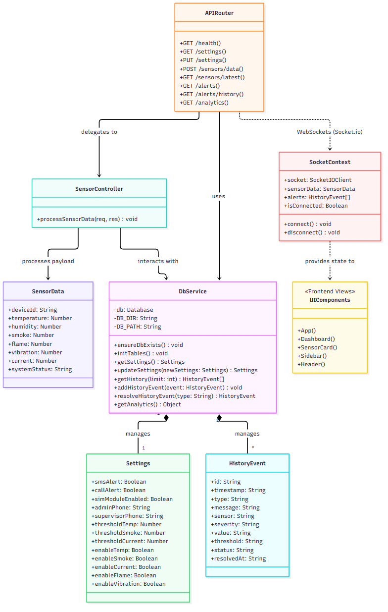
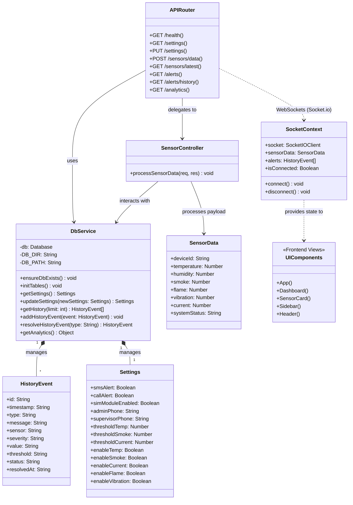

# Smart Workplace Safety Management Project - Class Diagram

This document contains the class diagram for the system architecture, representing both backend services and the frontend state management.

